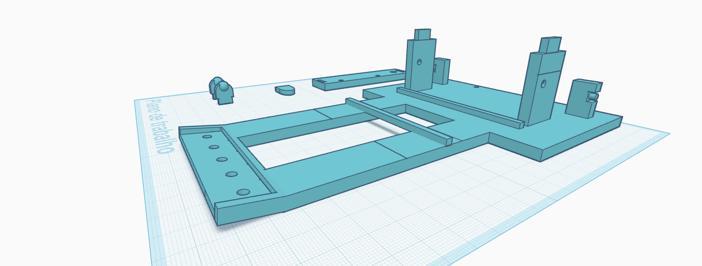
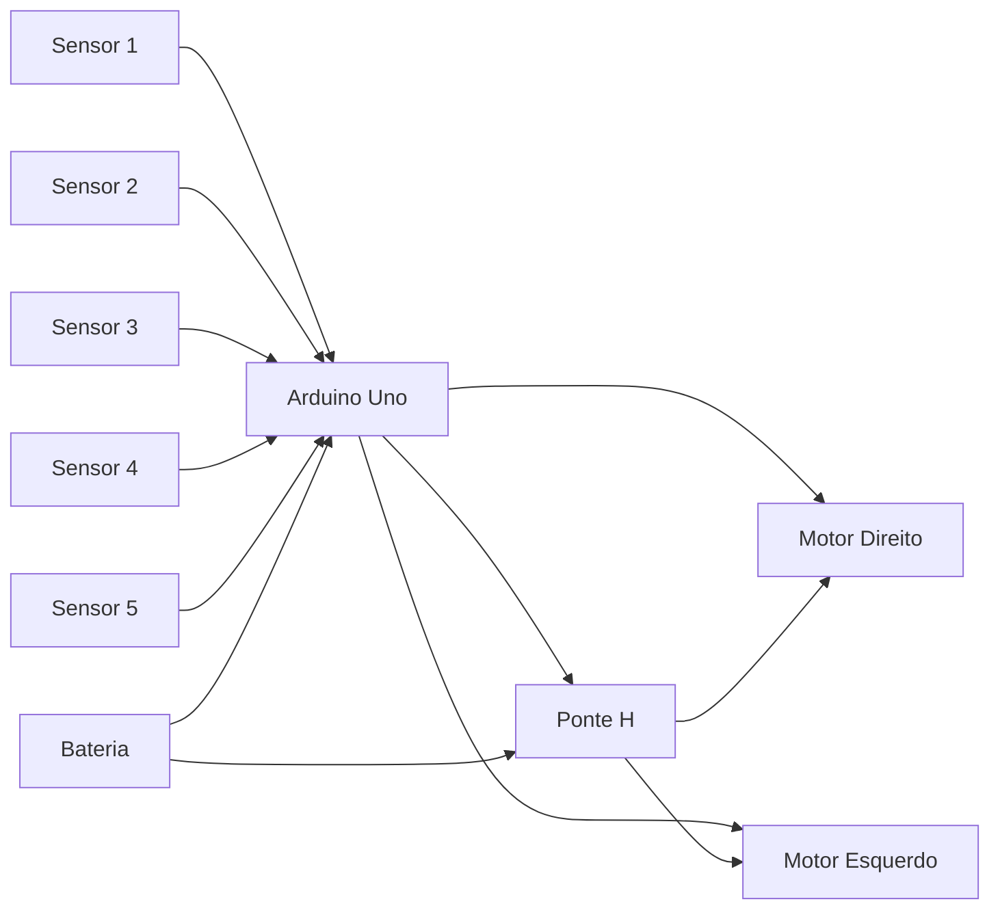

# SEGUIDOR DE LINHA 2026 OK

<p align="center">
  
</p>

<p align="center">
  
  
  
  
</p>

Robô seguidor de linha desenvolvido para robótica educacional e competições. O projeto usa Arduino para interpretar sensores de linha, ajustar a direção e manter o veículo seguindo uma trajetória com estabilidade.

## ✨ Visão geral

Este repositório reúne:

- o código principal do robô;
- imagens do projeto em operação;
- modelo 3D da estrutura para referência;
- documentação básica para montagem, uso e ajustes.

A lógica do código foi escrita em C++ para Arduino e usa cinco sensores para detectar a linha e corrigir a trajetória em tempo real.

## 🤖 Como funciona

O robô percorre a pista seguindo uma lógica simples, mas eficiente:

- sensor central: mantém avanço reto;
- sensores laterais suaves: corrigem pequenas desvios;
- sensores laterais fortes: fazem correções mais agressivas;
- ausência de leitura: o robô usa a última direção como referência para buscar novamente a linha.

Esse comportamento torna o sistema responsivo, simples de entender e muito bom para aprendizado prático.

## 🔌 Diagrama elétrico

A conexão principal pode ser visualizada assim:



## 📦 Materiais e hardware

| Componente | Descrição |
| --- | --- |
| Arduino Uno | Controlador principal do robô |
| 2 motores DC | Propulsão do chassi |
| 5 sensores de linha | Leitura da posição da faixa |
| Ponte H | Controle dos motores |
| Bateria | Alimentação do robô |
| Chassi mecânico | Estrutura física do veículo |
| Fios e conectores | Interligação dos componentes |

## 📁 Estrutura do repositório

```text
SEGUIDOR-DE-LINHA-2026-OK/
├── README.md
├── assets/
│   ├── SEGUIDOR.png
│   ├── SEGUIDOR (16).stl
│   ├── SEGUIDOR_LINHA (1).jpg
│   ├── SEGUIDOR_LINHA (2).jpg
│   ├── SEGUIDOR_LINHA (3).jpg
│   ├── SEGUIDOR_LINHA (4).jpg
│   ├── SEGUIDOR_LINHA (5).jpg
│   ├── SEGUIDOR_LINHA (6).jpg
│   └── SEGUIDOR_LINHA (7).jpg
└── SEGUIDOR_DE_LINHA_2026_OK/
    └── SEGUIDOR_DE_LINHA_2026_OK.ino
```

## ⚙️ Código principal

O firmware principal está localizado em:

- [SEGUIDOR_DE_LINHA_2026_OK/SEGUIDOR_DE_LINHA_2026_OK.ino](SEGUIDOR_DE_LINHA_2026_OK/SEGUIDOR_DE_LINHA_2026_OK.ino)

O arquivo implementa:

- definição dos pinos dos motores;
- leitura dos sensores;
- decisões de direção;
- movimento dos motores;
- parada do robô;
- saída serial para depuração.

## 🛠️ Montagem e conexão

1. Conecte os motores na ponte H.
2. Ligue a ponte H ao Arduino nas saídas digitais e PWM.
3. Conecte os sensores de linha aos pinos analógicos definidos no código.
4. Alimente o Arduino e os motores com a bateria adequada.
5. Teste a polaridade dos motores para garantir que o robô avance no sentido correto.

> Ajuste cuidadoso da polaridade e da posição dos sensores faz muita diferença no comportamento do robô.

## ▶️ Como executar

1. Abra o Arduino IDE.
2. Carregue o arquivo [SEGUIDOR_DE_LINHA_2026_OK/SEGUIDOR_DE_LINHA_2026_OK.ino](SEGUIDOR_DE_LINHA_2026_OK/SEGUIDOR_DE_LINHA_2026_OK.ino).
3. Selecione a placa Arduino Uno.
4. Escolha a porta COM correta.
5. Clique em "Enviar" para fazer o upload.
6. Posicione o robô sobre a linha e teste o comportamento.

## 🔧 Calibração e ajustes

Para obter melhor desempenho:

- ajuste a sensibilidade dos sensores conforme a cor e a espessura da linha;
- teste diferentes valores de velocidade para reduzir oscilações;
- confirme se os sensores estão alinhados e paralelos à linha;
- mantenha o centro de gravidade estável para evitar balanço excessivo.

Valores úteis para começar:

- velocidade base: 255;
- correção leve: 110/200 e 200/105;
- correção forte: 75/210 e 210/75.

Esses números podem ser ajustados conforme o tipo de pista e a estrutura do robô.

## 📷 Referências visuais

<p align="center">
  
  
</p>

Também é possível consultar o modelo 3D em:

- [assets/SEGUIDOR (16).stl](assets/SEGUIDOR%20(16).stl)

## 🧪 Diagnóstico rápido

Se o robô não seguir bem a linha:

- verifique a conexão dos sensores;
- confirme se os motores estão girando na direção correta;
- garanta que a linha esteja bem iluminada e contrastante;
- teste o monitor serial para inspecionar a leitura de cada sensor;
- revise a posição do chassi para evitar desbalanceamento.

## 🚀 Próximos passos

Melhorias recomendadas para o projeto:

- implementar controle PID para maior suavidade;
- adicionar calibração automática dos sensores;
- otimizar a estrutura mecânica para reduzir peso e oscilações;
- criar uma documentação detalhada de montagem e ajustes finos;
- testar em pistas mais complexas e rápidas.

## 📌 Observação final

Este projeto é uma excelente base para aprendizado em automação, eletrônica e robótica. Ele mostra como sensores, atuação e lógica de controle podem trabalhar juntos para transformar um conjunto de componentes em um sistema autônomo.

---

Desenvolvido com foco em robótica prática, experimentação e evolução contínua do projeto.
